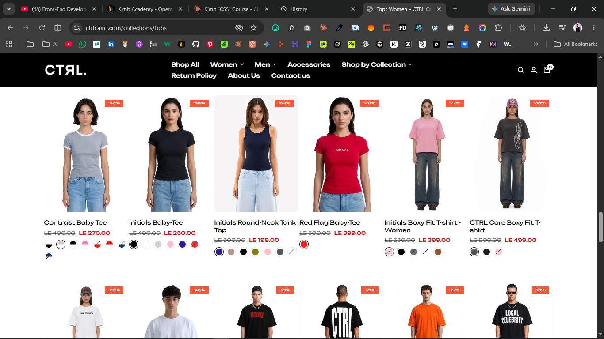
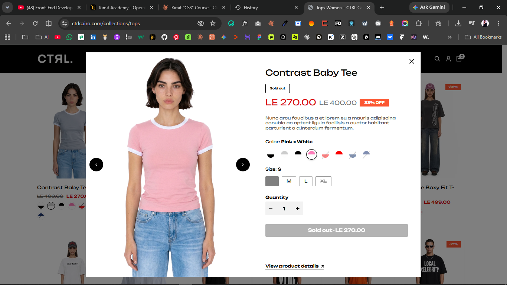

# PRD — Product Card Interactions (AURELLE)
**تفاعلات كرت المنتج:** Color-swatch image swap · Dual-image hover fade · Quick View / Quick Add

> الحالة: Draft · التاريخ: 2026-10-13 · المالك: Abanoub
> يتبع `PLAN.md` — نفس التصميم الموحّد (design-reference) يتلفّ بعدين في WooCommerce / Shopify / Salla.
> المرجع الملهِم: متجر Ctrl Cairo (ثيم Ecomus/Halo) — ده إعادة بناء من الصفر بأسلوب AURELLE، مش نسخ كود.

---

## 1. Context — ليه بنعمل ده
كروت المنتجات في الكتالوج (`shop.html` + Best Sellers في الهوم) حاليًا صورة + عنوان + سعر بس.
عايزين نرفع معدّل التفاعل والتحويل بثلاث مزايا hover قياسية في المتاجر الفخمة، **من غير دخول صفحة المنتج**:
1. **تبديل صورة الكرت حسب اللون** عند المرور على swatch اللون.
2. **صورتان بتأثير fade** عند المرور على الكرت (front / back shot).
3. **Quick View + Quick Add** كأزرار overlay على الصورة.

كله لازم يشتغل: ثنائي اللغة (AR/EN) · RTL/LTR · يحترم `prefers-reduced-motion` · لمس (موبايل) · لوحة مفاتيح (a11y).

---

## 1.1 توضيح بصري (Reference screenshots)
لقطات من المرجع الملهِم (Ctrl Cairo) لتوضيح الهدف — إعادة بناء بأسلوب AURELLE لا نسخ:

**الكتالوج — كروت بـ swatches ألوان أسفل كل منتج (FR-1) + بادج الخصم:**

**Quick View modal — معاينة كاملة (gallery + سعر/خصم + اختيار اللون والمقاس + Add to cart) بدون مغادرة الكتالوج (FR-3):**

---

## 2. Scope
### In scope
- كومبوننت كرت منتج واحد قابل لإعادة الاستخدام في المرجع (`design-reference/`)، ثم ماب لكل منصة.
- الثلاث تفاعلات أعلاه + حالاتها (hover / focus / touch / sold-out / variant واحد مقابل variants).
- Modal واحد مشترك للـ Quick View وآخر للـ Quick Add (أو modal واحد بوضعين).

### Out of scope
- صفحة المنتج الكاملة، التشيكآوت، الدفع (موجودين في PLAN).
- Wishlist / Compare / فلاتر الكتالوج (ممكن Phase لاحق).
- بحث فوري / توصيات.

---

## 3. المصطلحات (Data model)
كل كرت يُولّد من بيانات المنتج. الحقول المطلوبة لكل variant/لون:

| الحقل | الوصف | مثال |
|-------|-------|------|
| `product.handle` | مُعرّف المنتج للـ URL والـ modal | `silk-slip-dress` |
| `product.title` {ar,en} | العنوان ثنائي اللغة | «فستان حرير» / "Silk Slip Dress" |
| `product.price` / `compare_at` | السعر / سعر قبل الخصم | 2400 / 3000 |
| `media.main` | الصورة الأساسية | front shot |
| `media.hover` | صورة الـ hover (back/detail) — **اختيارية** | back shot |
| `color.label` {ar,en} | اسم اللون | «أسود» / "Black" |
| `color.swatch` | لون CSS أو صورة خامة (hex / url) | `#0E0E0E` |
| `color.variantId` | مُعرّف الـ variant للإضافة للسلة | `4670503…` |
| `color.image` | صورة الكرت الخاصة بهذا اللون | url |
| `color.available` | متاح/نافد | `true/false` |

> **مبدأ معماري:** البيانات تتحط على عناصر الـ DOM نفسها (`data-variant-id`, `data-variant-img`) عشان الـ JS يبدّل الصورة **من غير أي network call** — نفس أسلوب المرجع الملهِم. مصدر البيانات: JSON في المرجع، Liquid/PHP/Twig في المنصات.

---

## 4. المزايا بالتفصيل (Functional Requirements)

### FR-1 — Color swatch → image swap
**السلوك:** المرور (hover) على swatch لون داخل الكرت يبدّل صورة الكرت الأساسية لصورة ذلك اللون فورًا؛ مغادرة قائمة الألوان يرجّع الصورة الافتراضية. على اللمس (موبايل) = tap بدل hover، ويثبّت الاختيار.

- `FR-1.1` الـ swatches عبارة عن `radio inputs` مخفية + `label` ملوّن (مش `div`) → accessible وقابلة للاختيار بلوحة المفاتيح.
- `FR-1.2` الاختيار يحدّث أيضًا الـ `variantId` النشط المستخدم في Quick Add، وبادج "محدد".
- `FR-1.3` حد أقصى للـ swatches الظاهرة (مثلاً 4) + "‎+N" لو أكتر؛ الباقي يظهر في Quick View.
- `FR-1.4` اللون النافد (`available:false`) يظهر بخط قطر (disabled visual) ولا يُضاف للسلة.
- `FR-1.5` تبديل الصورة preload للصورة التالية لتفادي الوميض.

**Acceptance:** مرور على swatch «أسود» → صورة الكرت تبقى النسخة السوداء خلال < 100ms بدون layout shift؛ مغادرة → ترجع الافتراضية؛ اختيار بلوحة المفاتيح (Tab→Arrow) يعمل نفس الشيء.

### FR-2 — Dual-image hover fade
**السلوك:** الكرت يحوي صورتين متراكبتين؛ عند hover تظهر الثانية بتأثير **fade** ناعم (opacity) فوق الأولى، مش قطع مفاجئ.

- `FR-2.1` الصورة الثانية `position:absolute; inset:0; opacity:0`، تنتقل لـ `opacity:1` على `.card:hover` بمدة `.4s` و easing المشروع `cubic-bezier(0.44,0,0.56,1)`.
- `FR-2.2` لو مفيش `media.hover` → الكرت يعمل fade خفيف/zoom بسيط للصورة الأساسية بدل إخفائها.
- `FR-2.3` يتوقف التأثير مع `prefers-reduced-motion: reduce` (تظهر الأساسية فقط).
- `FR-2.4` على اللمس: لا hover — تُعرض الأساسية فقط (الثانية تظهر في Quick View / صفحة المنتج).
- `FR-2.5` يتكامل مع FR-1: لو اللون اتبدّل، صورتا (main/hover) تبقيا لنفس اللون النشط.

**Acceptance:** hover على الكرت → الصورة الخلفية تظهر بتدرّج سلس بدون وميض؛ مع reduced-motion التأثير معطّل.

### FR-3 — Quick View & Quick Add
**السلوك:** طبقة أزرار overlay تظهر على الصورة عند hover/focus:
- **Quick Add** (أيقونة سلة): لو variant واحد → يضيف للسلة فورًا + toast. لو له variants → يفتح **Quick Add modal** صغير لاختيار المقاس/اللون ثم الإضافة.
- **Quick View** (أيقونة عين): يفتح **modal معاينة** (gallery + عنوان + سعر + اختيار variant + Add to cart + رابط "View full details") بدون مغادرة الكتالوج.

- `FR-3.1` الأزرار مخفية بصريًا في الراحة، تظهر بـ fade/translateY عند hover؛ على الموبايل **ظاهرة دائمًا** (مفيش hover).
- `FR-3.2` نص كل زر `sr-only` + أيقونة SVG؛ `aria-haspopup="dialog"`, `aria-expanded`, `aria-controls`.
- `FR-3.3` الـ modal: focus trap، إغلاق بـ Esc / النقر على الخلفية / زر X، إرجاع الـ focus للزر، `role="dialog" aria-modal="true"`.
- `FR-3.4` Quick Add لمنتج sold-out → الزر disabled + نص "نفد".
- `FR-3.5` نجاح الإضافة → تحديث عدّاد السلة + toast + (اختياري) فتح cart drawer.
- `FR-3.6` محتوى الـ modal ثنائي اللغة ويتبع اتجاه `dir` الحالي.

**Acceptance:** Quick Add لمنتج بمقاسات يفتح modal اختيار → إضافة تحدّث العدّاد؛ Quick View يعرض المعاينة ويُغلق بـ Esc مع رجوع الـ focus؛ الكل شغّال AR/EN + RTL.

---

## 5. Non-functional
- **Performance:** CLS ≈ 0 (نسبة أبعاد ثابتة للصورة `aspect-ratio`)، lazy-load للصور، preload لصورة hover عند أول تفاعل، JS مفوّض بـ event delegation (listener واحد للجريد مش لكل كرت).
- **A11y:** WCAG AA — تباين، focus-visible واضح، swatches/أزرار قابلة للوصول بلوحة المفاتيح، أسماء ألوان نصية للـ screen readers.
- **RTL:** logical properties (`inset-inline`, `margin-inline`) + طبقة `[dir=rtl]` خفيفة؛ موضع الأزرار/البادج يتعكس صح.
- **Motion:** easing المشروع + احترام reduced-motion في كل تأثير.
- **المتصفحات:** آخر نسختين Chrome/Safari/Firefox/Edge + iOS/Android.

---

## 6. التصميم (مربوط بـ tokens المشروع)
- الخلفية `--bg #0E0E0E` / `--bg-2 #161616`؛ النص `--fg`/`--muted`؛ الحدود `--line`.
- أزرار overlay: خلفية فاتحة شفافة، hover يعكس (fill ↔ bg) زي نمط AURELLE الهادئ.
- بادج ("Best Seller" / "New") أعلى الكرت، لا يتداخل مع الأزرار (z-index: صورة < بادج < أزرار).
- swatch دائري صغير (`border-radius:50%`) مع ring عند الاختيار/الـ focus.

**z-index داخل الكرت:** `media--main` < `media--hover` < `badge` < `product-btns`.

---

## 7. ملاحظات التنفيذ لكل منصة (Mapping)
| الطبقة | FR-1 Swatch | FR-2 Fade | FR-3 Quick View/Add |
|--------|-------------|-----------|---------------------|
| **Reference (HTML/JS)** | JSON + `data-*` + vanilla JS swap | CSS opacity transition | modal عادي + `cart-demo.js` (localStorage) |
| **WooCommerce** | variations من المنتج المتغيّر + `data-*` في `content-product.php` | نفس CSS | AJAX add-to-cart + `wc-add-to-cart`؛ Quick View عبر hook/endpoint |
| **Shopify (OS2.0)** | `product.options_with_values` + `variant.featured_image` في snippet | نفس CSS | `/cart/add.js` (AJAX API) + section/modal |
| **Salla (Twilight)** | `product.options` في Twig + `data-*` | نفس CSS | Salla JS SDK `salla.cart.addItem` + modal |

> نكتب الماركب + CSS + JS **مرة واحدة في المرجع**، وبعدين كل منصة بتبدّل مصدر البيانات بس (Liquid/PHP/Twig) وتربط الـ add-to-cart بالـ API بتاعها.

---

## 8. حالات الحافة (Edge cases)
- منتج بلون واحد فقط → إخفاء قائمة الـ swatches.
- منتج بصورة واحدة → لا fade ثانية (FR-2.2).
- كل الألوان نافدة → كرت sold-out، Quick Add disabled.
- أسماء ألوان طويلة / RTL → tooltip/clamp.
- شبكة بطيئة → skeleton/placeholder لحد تحميل الصورة.
- تبديل اللغة والـ modal مفتوح → المحتوى يتحدّث للاتجاه الصحيح.

---

## 9. Verification (ملخّص قبول)
1. **Reference** في البراوزر الداخلي: hover swatch يبدّل الصورة · hover كرت يعمل fade · Quick View/Add modals تفتح وتضيف للسلة التجريبية · AR/EN + RTL · reduced-motion · لمس · لوحة مفاتيح.
2. **WooCommerce:** منتج متغيّر تجريبي → swatch/fade/quick add (AJAX) تحدّث السلة.
3. **Shopify:** dev store → `/cart/add.js` تنجح، variant image يتبدّل.
4. **Salla:** متجر Partner → `salla.cart.addItem` تنجح.

---

## 10. مفتوح للنقاش (Open questions)
- Quick Add لمنتج بمقاسات: modal صغير أم إضافة المقاس الافتراضي مباشرة؟ (الحالي: modal).
- عدد الـ swatches قبل "‎+N"؟ (مقترح 4).
- نجاح الإضافة: toast فقط أم فتح cart drawer؟
- نعرض بادج الخصم (`compare_at`) على الكرت؟
